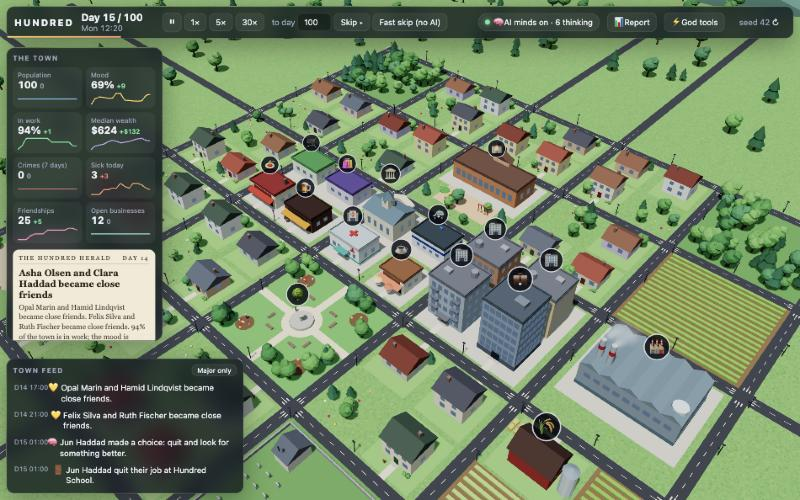
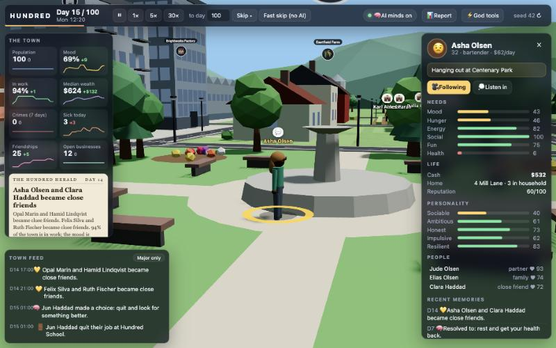
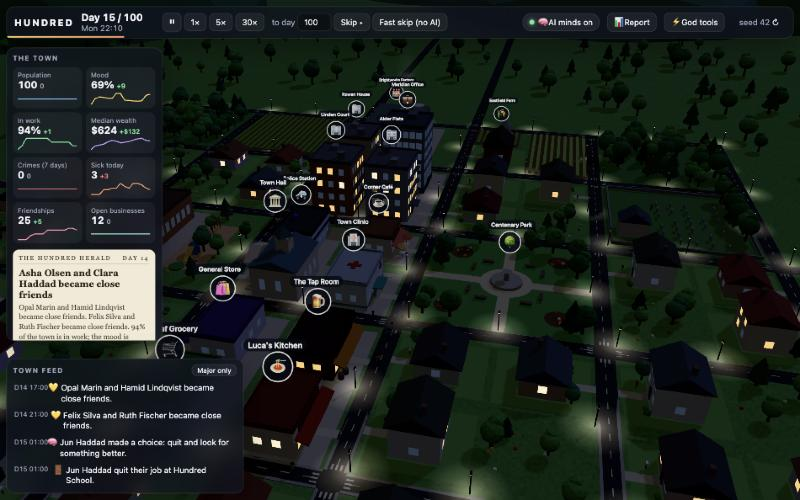
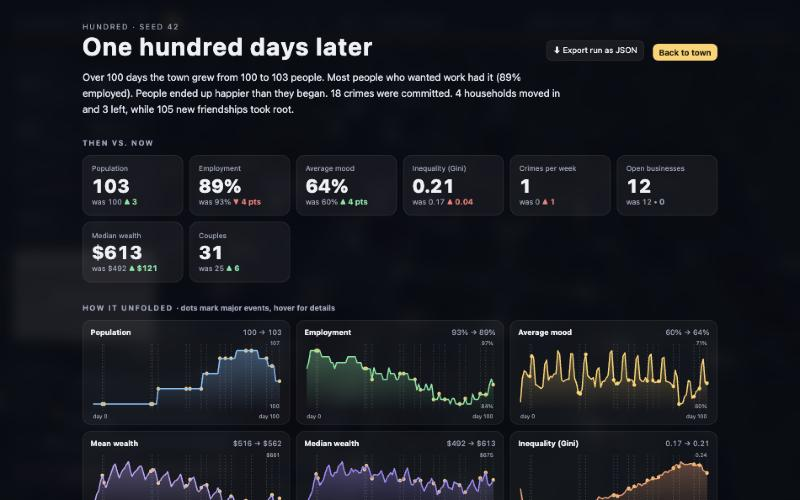
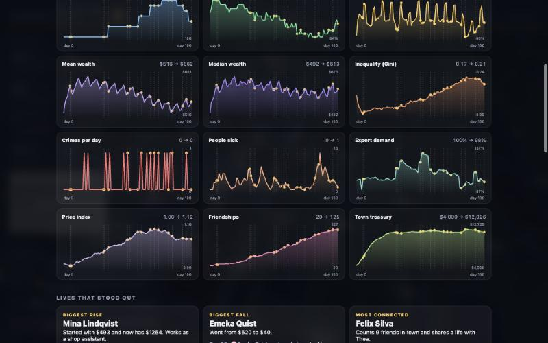

# HUNDRED

**100 people. 100 days. One small 3D town, simulated entirely in your browser.**

Watch from above like SimCity, drop down to street level like The Sims, and follow anyone's life. After 100 simulated days you get a report on what changed in the town and in people's lives. Then rerun the same seed with one policy changed and see a different town.

It is a static site. No backend, no API keys, no paid services, no downloaded art. Buildings, people, textures and icons are all generated in code.



## What you get

- **A living 3D town.** About 55 procedural buildings (houses, apartments, school, clinic, police station, town hall, shops, bar, factory, office, farm, park, pond, woods, cemetery), with a day and night cycle, lamps, lit windows and factory smoke.
- **People who look like people.** Head, hair, eyes, torso, arms, legs and shoes, in different skin tones, hairstyles, heights and clothes. Children carry backpacks, police and clinic staff wear uniforms, seniors stoop, and the sick slump. They walk, sit on park benches and sway when idle.
- **City to street in one scroll.** Tilt follows zoom: top-down from afar, near eye level up close. Click anyone to inspect them, or press `F` to follow.
- **Lives that interact.** Everyone has a home, a temperament, needs, money worries, friends and rivals. They work, fall out, fall in love, move in together, get sick, lose jobs, steal, get arrested, and sometimes leave town while newcomers arrive.
- **A report on Day 100.** Then vs. now cards, twelve charts with major events marked, standout life stories, a town timeline and a full JSON export. It is available at any time, not only at the end.
- **Small AI minds, on by default.** A language model that runs in your browser sets people's intentions and settles their big dilemmas, under a strict daily budget. With no WebGPU it falls back to rules, and the town still runs all 100 days.





## Quick start

```bash
npm install
npm run dev        # http://localhost:5173
```

Open the page, pick a seed (or keep 42), and press **Begin Day 1**. The town starts on rules while the model downloads, then switches over.

| Command | What it does |
|---|---|
| `npm run dev` | Vite dev server |
| `npm run build` | Type-check and build the static site into `dist/` |
| `npm run preview` | Serve the production build locally |
| `npm test` | Vitest suite |
| `npm run typecheck` | `tsc --noEmit` |
| `npm run sim -- --days 100 --seed 42` | Headless 100-day run with invariant checks |
| `sh scripts/seeds.sh` | Compare six seeds side by side (for tuning) |

## Controls

| Input | Action |
|---|---|
| Drag / `WASD` / arrows | Pan |
| Right-drag / `Q` `E` | Rotate |
| Scroll / `+` `-` / pinch | Zoom |
| Click a person or building | Inspect |
| `F` | Follow the selected person |
| `Space` | Pause or resume |
| `1` `2` `3` | 1x, 5x, 30x |
| `Esc` | Deselect, close panels |

Top bar: speed buttons, **Skip** to any day (with AI minds), **Fast skip (no AI)** (rules only, zero model calls), **Report**, **God tools** and the seed.

God tools: close the factory, send a $300 stimulus to every adult, start a flu outbreak, double the police. They also hold the AI budget slider.

## The AI minds

On load the app fetches a small instruct model, **Llama 3.2 1B (4-bit)**, with [WebLLM](https://github.com/mlc-ai/web-llm). It runs in a Web Worker on WebGPU, and the browser caches it after the first visit. A progress bar shows the download. If WebGPU is missing or loading fails, the app says so and keeps running on rules.

The model never writes behaviour directly. It only picks from a numbered list the simulation builds, and anything that does not parse falls back to the rule-based choice.

| Use | Effect | Budget per sim day |
|---|---|---|
| Daily intentions | Sets a goal ("find a better job", "make peace with Sam") that biases someone's choices for a few days, for the people whose lives changed most plus a rotating few | 8 |
| Dilemmas | Picks one option: steal, quit, move in together, report a friend, leave town | 3 |
| Newspaper | Headline and blurb from the day's events (flavour only) | 1 |
| Inner voice, final chronicle | Flavour text on demand | outside the budget |

The default is **12 automatic calls per sim day** (adjustable from 0 to 30), enforced in code and covered by tests.

- The per-minute tick **never waits** on the model. Dilemmas give people up to 60 sim minutes to mull before the rule choice applies. At 30x and Skip, the clock holds at dawn for the night's batch, with a 20 second timeout.
- Every model decision is logged. A run can be replayed exactly from its log, even though the model is not deterministic (a test checks this).
- Measured on one machine: about 0.5 s per call. A full 100-day run with AI on takes roughly 6 to 8 minutes of wall time at the default budget, while Fast skip takes about 10 seconds. Lower the budget to trade intelligence for speed.
- The model is small. Its prose can embellish, so the report keeps a rule-written summary at the top and labels the model's chronicle.

## The Day 100 report





## How it works

```
src/sim/      deterministic simulation: pure TypeScript, no DOM, no Three.js, seeded RNG only
src/render/   Three.js scene: procedural city, instanced humanoid peds, day/night, camera
src/ui/       DOM panels: top bar, feed, inspector, town charts, report, God tools
src/mind/     LlmMind (WebLLM in a Worker, default) and RuleMind (fallback, tests, headless)
scripts/      headless runner
tests/        Vitest suite
```

Data flows one way, from `sim` to `render` and `ui`. User input goes back through explicit sim API calls (speed, God tools). The sim never imports from the other layers, so it runs in Node.

- **Time.** One tick is one sim minute, so a day is 1,440 ticks. Agents only decide when their current action ends. Rendering interpolates positions between ticks.
- **Decisions.** A utility AI scores each possible action as `need urgency x trait x intention bias x feasibility + seeded noise`. Intentions are short-lived tags that bias those weights.
- **Systems that make Day 100 differ from Day 1.**
  - *Economy:* businesses pay wages from their own cash, industries earn from a drifting export demand (the main source of shocks), and short-of-cash firms lay off staff or close.
  - *Relationships:* affinity moves with compatibility, mood and gossip, with thresholds for friend, close friend, rival, dating, partner and break-up.
  - *Crime:* desperate, low-honesty people may steal, witnesses may report, and arrests depend on police staffing.
  - *Health:* illness spreads between people sharing a room, and the clinic speeds recovery.
  - *Migration:* the long-term unemployed and unhappy leave, and newcomers arrive when there are homes and jobs.
- **Peds.** One `InstancedMesh` per body part, so everyone costs about a dozen draw calls, with a procedural walk cycle and blob shadows. Routes between every pair of doors are computed once and cached.
- **Money is conserved.** Cash only enters or leaves town through named sources (state grant, exports, immigration, investment, stimulus) and sinks (imports, overhead, profits, emigration). A ledger check runs every simulated day.
- **Tunables.** Every balance constant lives in `src/sim/config.ts` with a short comment. Tuning was done by comparing several seeds headless, not by guesswork.

## Verification

`npm run sim -- --days 100 --seed 42` prints the town's before and after, the money ledger and the stories, and fails if any of these break:

- no NaN or infinite values in agent or business state
- no agent stuck in one action for more than a day
- population between 60 and 128
- the money ledger drifts
- two runs of the same seed give different state hashes
- model calls exceed the daily budget

A 100-day headless run takes well under a second. In the browser, Fast skip to Day 100 takes about 10 seconds.

## Deploy

It is a static site: build with `npm run build` and serve `dist/`. Asset paths are relative, so it works from any host or sub-path, and no special headers are needed.

- **Vercel:** import the repo (`vercel.json` is included) or run `npx vercel`.
- **Netlify, Cloudflare Pages, GitHub Pages:** build command `npm run build`, output directory `dist`.

The first visit downloads the model (hundreds of MB) from Hugging Face's CDN, which is the only network request the app makes. WebLLM then keeps it in the browser cache.

## Tech

Vite, TypeScript (strict), Three.js (`WebGLRenderer`), Vitest, WebLLM, and hand-rolled SVG charts. The UI is vanilla DOM and CSS with no framework.

`plan.md` holds the full design and milestone history.
